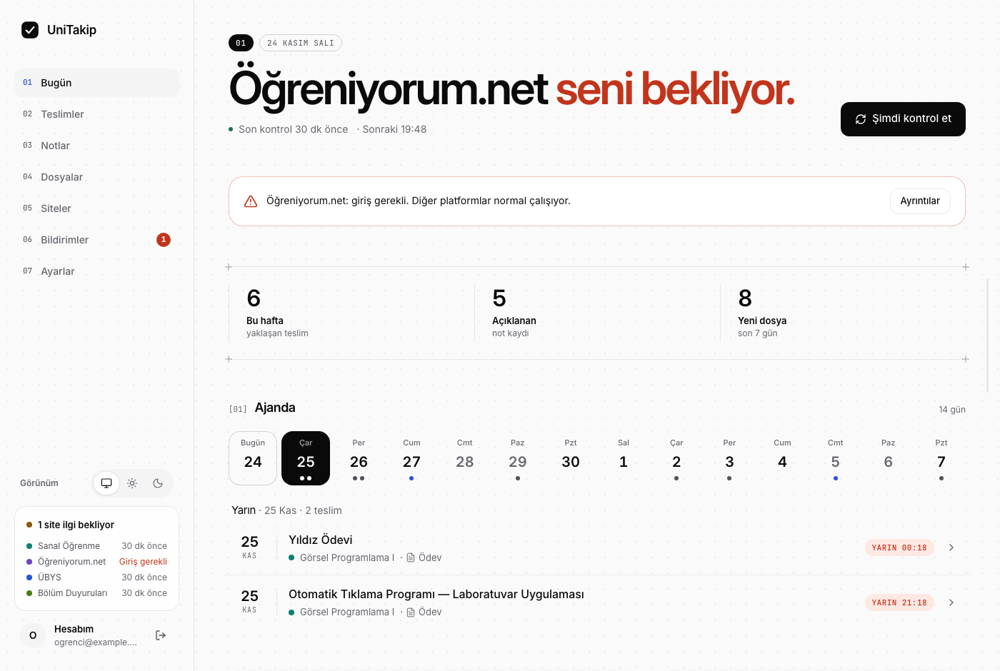
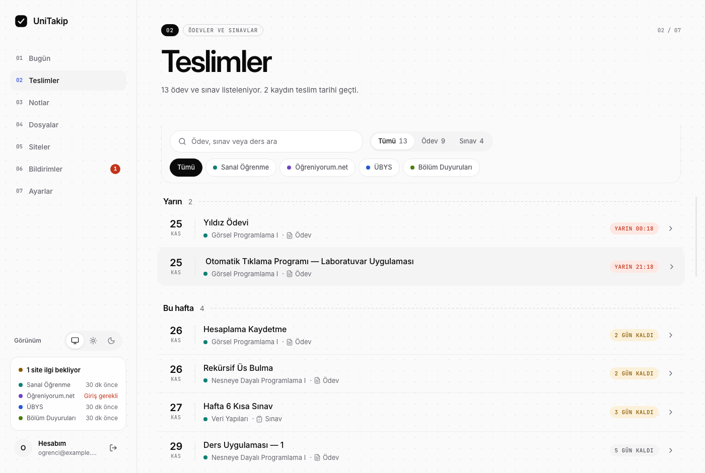
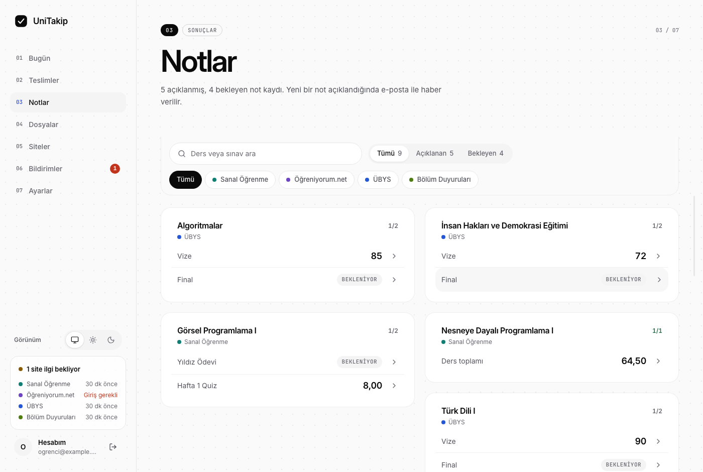

# UniTakip

**Üniversite ders sitelerindeki ödevleri, sınavları, notları ve duyuruları tek panelden takip et.**

UniTakip; farklı okul sistemlerindeki yaklaşan teslimleri, açıklanan notları, yeni dosyaları ve duyuruları düzenli aralıklarla kontrol eder. Değişiklik olduğunda Gmail üzerinden haber verir. Panel telefonda ve bilgisayarda çalışır; Cloudflare üzerinde yayımlandığı için kendi bilgisayarın kapalıyken de takip devam eder.

> [!IMPORTANT]
> Bu depo bir SaaS hizmeti değil, kendi hesabına kurduğun kişisel bir takip sistemidir. Okul ve Gmail bilgilerin geliştiriciyle paylaşılmaz; oturumları ve anahtarları kendi bilgisayarında ve kendi Cloudflare hesabında yönetirsin.

[Ekran görüntüleri](#ekran-görüntüleri) · [İndirme](#indirme) · [Hızlı demo](#hızlı-demo) · [Cloudflare kurulumu](#cloudflare-kurulumu) · [Classroom](#classroom-kurulumu) · [e-Devlet terminal komutu](#e-devlet-terminal) · [Destek](#destek)

## Özellikler

- Yaklaşan ödevleri ve sınavları teslim tarihine göre tek ekranda toplar.
- Yeni açıklanan notları, eklenen dosyaları ve duyuruları algılar.
- Gmail ile değişiklik ve yeniden giriş bildirimi gönderir.
- Eklenen adresi otomatik test eder. Herkese açık sitelerde duyuru arşivini veya RSS/Atom akışını arar.
- Bir sitenin oturumu kapanınca diğer etkin siteleri izlemeye devam eder.
- Açık/koyu tema ve telefon uyumlu web paneli içerir.

| Kaynak | Takip edilenler | Giriş yenileme |
| --- | --- | --- |
| **Sanal Öğrenme** | Ödevler, sınavlar, notlar, dosyalar ve duyurular | Kullanıcı adı/şifre veya kayıtlı oturum |
| **Öğreniyorum.net** | Ders etkinlikleri ve teslimler | Kullanıcı adı/şifre veya kayıtlı oturum |
| **Bartın BTBS ve Fen Fakültesi** | Arşivdeki duyuruların başlığı, tarihi ve bağlantısı | Giriş gerekmez |
| **Google Classroom** | Etkin öğrenci derslerinin ödevleri ve duyuruları | [Apps Script kurulumu](docs/google-classroom.md#otomatik-kurulum) · [Ortak Google bağlantısı pilotu](docs/google-classroom.md#ortak-google-bağlantısı) |
| **ÜBYS** | Tanımlanan ders ve not sayfaları | ÜBYS kullanıcı adı ve şifresiyle panelden, yalnızca e-Devlet kullanıyorsan kurulum bilgisayarından. [Yeniden giriş adımları](#yeniden-giris) |

Bu sürüm, kendi derslerimi takip etmek için kullandığım UniTakip sisteminin herkese açık kopyasıdır. Kurulumda paneli kendi Cloudflare hesabında yayımlar, bildirimler için kendi Gmail hesabını bağlar ve izleyeceğin okul sitelerine kendi hesabınla giriş yaparsın.

## Ekran görüntüleri

Örnek verilerle çalışan panelin **Bugün** ekranı yaklaşan teslimleri ve yeniden giriş isteyen siteleri gösterir.



| Teslimler | Notlar |
| --- | --- |
| [](docs/gorseller/teslimler.png) | [](docs/gorseller/notlar.png) |

<a id="indirme"></a>

## Projeyi indir

Git ve npm içeren **Node.js 24** kur. Cloudflare üzerinde gerçek takip için ayrıca **Python 3.12 veya üzeri**, bir Cloudflare hesabı ve uygulama şifresi oluşturabilen bir Gmail hesabı gerekir. Bu kurulum komutlarını macOS veya Linux terminalinde, Windows’ta ise **WSL** terminalinde çalıştır. WSL kullanıyorsan Git, Node.js ve Python’u WSL içine kur.

```sh
git clone https://github.com/BerkDrmz/unitakip-public.git unitakip
cd unitakip
node --version
npm ci --prefix cloud/cloudflare
npm ci --prefix cloud/cloudflare/ui
```

ZIP ile indirdiysen arşivi aç ve terminali `README.md` ile `cloud` klasörünün bulunduğu dizinde aç. `node --version` ve iki `npm ci` komutuyla devam et. Aşağıdaki adımlarda **proje klasörü** bu dizini ifade eder.

## Hızlı demo

Paneli örnek ödev ve notlarla denemek için proje klasöründe çalıştır. Demo adımı isteğe bağlıdır.

```sh
UNITAKIP_UI_DEMO=1 UNITAKIP_UI_DEMO_RICH=1 npm --prefix cloud/cloudflare/ui run dev
```

[Demo panelini aç](http://127.0.0.1:5174), **Giriş kodu gönder** düğmesine bas ve `123456` kodunu gir. Kapatmak için terminalde **Ctrl+C** tuşlarına bas.

<a id="cloudflare-kurulumu"></a>

## Cloudflare kurulumu ve arka plan takibi

İndirme ve bağımlılık kurulumundan sonra bu adımları sırayla tamamla. Cloudflare paneli, takip kayıtlarını ve zamanlanmış kontrolleri kendi hesabında barındırır. Kurulum bittiğinde terminali kapatıp paneli telefondan veya bilgisayardan kullanabilirsin.

### 1. Python ortamını hazırla

Proje klasöründe `python3 --version` çalıştır. Çıktı en az 3.12 olmalı. Bilgisayarında birden fazla Python varsa ilk satırda `python3` yerine uygun sürüm komutunu kullanabilirsin. [Python indirmeleri](https://www.python.org/downloads/)

```sh
python3 -m venv .venv
.venv/bin/python -m pip install -e .
.venv/bin/python -m playwright install chromium
.venv/bin/unitakip init
```

`unitakip init`, `config/config.yaml` dosyasını ve yerel şifreleme anahtarını hazırlar. Linux veya WSL’de Chromium sistem kütüphanesi hatası verirse `.venv/bin/python -m playwright install --with-deps chromium` çalıştır. [Playwright tarayıcı kurulumu](https://playwright.dev/python/docs/browsers)

### 2. Gmail giriş kodlarını ve bildirimleri ayarla

`config/config.yaml` içindeki mevcut `notify` bölümünde şu iki alanı düzenle. `to` alanına giriş kodlarını ve bildirimleri almak istediğin kendi adresini yaz. Bölümdeki diğer ayarları olduğu gibi bırak.

```yaml
notify:
  provider: gmail_smtp
  to: "senin-adresin@example.com"
```

Gönderen Gmail hesabında iki adımlı doğrulamayı aç ve UniTakip için 16 karakterlik bir uygulama şifresi oluştur. Proje klasöründe aşağıdaki komutları çalıştır. `smtp-auth` gönderen Gmail adresini ve uygulama şifresini sorar. Gönderen ve alıcı aynıysa adres sorusunda **Enter**’a bas. Uygulama şifresi terminalde görünmeden alınır. [Gmail uygulama şifresi oluştur](https://myaccount.google.com/apppasswords) · [Google’ın hesap koşulları](https://support.google.com/accounts/answer/185833)

```sh
.venv/bin/unitakip smtp-auth
.venv/bin/python cloud/cloudflare/prepare.py
```

İlk komut Gmail oturumunu doğrular. İkinci komut Cloudflare’a yüklenecek yerel `data/cloudflare/secrets.json` dosyasını hazırlar. Uygulama şifresini yalnızca `smtp-auth` istemine gir. `secrets.json`, `.env` ve `data/` klasörünü özel tut.

### 3. Paneli kendi Cloudflare hesabında yayımla

Cloudflare’da **Workers & Pages** bölümünde kendine bir `workers.dev` alt alanı seç. [Worker ayarları](cloud/cloudflare/wrangler.jsonc) dosyasında `PANEL_URL` değerine `https://unitakip.ornek-hesap.workers.dev` biçimindeki kendi adresini, sondaki `/` olmadan yaz. Böylece e-postalardaki bağlantılar senin panelini açar. [Cloudflare alt alan rehberi](https://developers.cloudflare.com/workers/configuration/routing/workers-dev/)

```sh
cd cloud/cloudflare
npx wrangler login
npx wrangler whoami
```

Tarayıcıdaki Cloudflare iznini onayla. `whoami` çıktısında kendi hesabını gördüğünde aynı terminalde devam et. Dağıtım komutu paneli derler ve `secrets.json` içindeki ayarları Worker’a gizli değişken olarak yükler. [Cloudflare Worker gizli değişkenleri](https://developers.cloudflare.com/workers/configuration/secrets/#upload-secrets-alongside-code)

```sh
npm run deploy -- --secrets-file ../../data/cloudflare/secrets.json
cd ../..
```

### 4. Gmail bağlantısını doğrula ve takibi başlat

Terminal proje klasöründeyken aşağıdaki ilk komutta örnek adres yerine Cloudflare’ın dağıtım sonunda gösterdiği kendi `https://…workers.dev` adresini yaz. Gmail kontrolü başarılı olunca bu adres sonraki komutlar ve Classroom kurulumu için yerelde kaydedilir.

```sh
node cloud/cloudflare/manage.mjs smtp-check "https://unitakip.ornek-hesap.workers.dev" &&
  node cloud/cloudflare/manage.mjs start &&
  node cloud/cloudflare/manage.mjs status
```

`status` çıktısında `"armed":true` görünüyorsa takip açıktır. İlk kurulumda site sayısının sıfır olması normaldir. Gmail’e bir iletinin ulaştığını aşağıdaki panel giriş koduyla doğrulayabilirsin.

### 5. Panele gir ve bir siteyi bağla

1. Kendi `workers.dev` adresini telefondan veya bilgisayardan aç. **Giriş kodu gönder** ile Gmail’e gelen kodu gir.
2. **Siteler → Site ekle** bölümüne okul sitesinin HTTPS adresini yapıştır ve **Ekle**’ye bas. UniTakip bağlantıyı test eder. Kart, ödev, not ve duyuru gibi hangi verileri okuyabildiğini gösterir. Site giriş isterse [yeniden giriş adımlarını](#yeniden-giris) kullan. Classroom için [kurulum komutu](#classroom-kurulumu) siteyi de otomatik ekleyebilir.
3. **Bugün → Şimdi kontrol et** ile ilk taramayı iste. **Siteler** bölümündeki kartta **Son başarılı kontrol** zamanını ve okunan içerikleri doğrula. İlk tarama bir başlangıç kaydı oluşturur. Bildirimler sonraki değişikliklerde gelir.

`.env`, yerel `config/` dosyalarını ve `data/` klasörünü güvenli bir yerde yedekle.

<a id="classroom-kurulumu"></a>

## Google Classroom kurulumu

Cloudflare kurulumu bitince ve `"armed":true` görününce UniTakip proje klasöründe şu komutu çalıştır.

```sh
npm --prefix cloud/cloudflare run classroom:setup
```

Tarayıcıda derslerini gördüğün Google hesabını seç. Google önce kurulum aracına, ardından Apps Script projesinin Classroom erişimine izin isteyebilir. İzinleri verince ilk aktarım otomatik başlar. Google sayfası aktarımın tamamlandığını gösterdiğinde **Siteler → Google Classroom** kartında **Son Apps Script aktarımı** zamanına, **Teslimler** bölümünde ödevlerine bak. Sonraki aktarımlar saatte bir çalışır. [Adım adım Classroom rehberi ve hata çözümleri](docs/google-classroom.md#otomatik-kurulum)

<a id="ubys-sayfalari"></a>

### ÜBYS’de ilk kez hangi sayfalar izlenecek?

Önce [e-Devlet terminal komutuyla](#e-devlet-terminal) kurulum bilgisayarında ÜBYS oturumunu aç. Ardından proje klasöründe şu komutu **ilk kurulumda** çalıştır. Bu komut sayfa önerilerini yazar. Önceden elle düzenlediğin bir `config/ubys.pages.yaml` varsa önce yedeğini al.

```sh
.venv/bin/unitakip discover ubys --apply
```

`config/ubys.pages.yaml` dosyasını aç. Kendi döneminin not veya ders sayfaları listelenmiş mi kontrol et. Dosya oluşmadıysa ya da yalnızca ana sayfa görünüyorsa [sayfaları elle ekleme adımını](docs/08-kurulum.md#ubys-sayfa-listesi) uygula. Sonra güncel listeyi kendi Worker’ına aktar.

```sh
.venv/bin/python cloud/cloudflare/prepare.py
(cd cloud/cloudflare && npx wrangler secret bulk ../../data/cloudflare/secrets.json)
```

**Siteler → ÜBYS → Bağlantıyı test et** sonucunda beklediğin içerikten bir örnek ara. Ardından **Bugün → Şimdi kontrol et** ile kayıtları panele getir. Sonraki oturum yenilemelerinde aynı sayfaları yeniden tanıtman gerekmez.

### Cloudflare’ın çalıştığını nasıl kontrol ederim?

UniTakip’te **Siteler** sayfasını aç. Bir sitenin kartındaki **Son başarılı kontrol** zamanı, Cloudflare’ın o siteyi en son ne zaman okuyabildiğini gösterir. Varsayılan tam tarama aralığı 60 dakikadır. Arada 10 dakikalık arka plan kontrolleri ve bunların ortasında yalnızca ÜBYS oturumu için ek bir yoklama vardır. Bu yoklama, okulun süresini doldurduğu oturumu yeniden açamaz.

Cloudflare tarafında **Workers & Pages → unitakip → Settings → Trigger Events → View events** yolundan zamanlanmış çalışmaları görebilirsin. İki zamanlama dağıtım sırasında proje ayarlarından kurulur. [Cloudflare zamanlanmış görevler rehberi](https://developers.cloudflare.com/workers/configuration/cron-triggers/)

<a id="yeniden-giris"></a>

## Panelden veya okul sitesinden çıkış olursa

| Ekranda ne görüyorsun? | Ne yapmalısın? |
| --- | --- |
| **UniTakip giriş ekranı** | Kendi panel adresini aç, **Giriş kodu gönder** düğmesine bas ve Gmail’e gelen kodu gir. Bu işlem telefonda da bilgisayarda da çalışır. Panel oturumunun kapanması arka plan takibini durdurmaz. |
| **Bir okul sitesinde “Giriş gerekli”** | Gmail’deki yeniden bağlanma bağlantısını aç veya panelde **Siteler → ilgili site → Panelden yeniden bağlan** yolunu izle. Sitenin kendi kullanıcı adı ve şifresiyle giriş destekleniyorsa telefondan da bilgisayardan da **Bağlan**’a bas. Site SMS kodu isterse kodu gir ve **Doğrula**’ya bas. Eski bir uyarı seni **Bugün** ekranına getirirse **Siteler** kartına bak. Oturum arada düzelmişse yeni giriş gerekmez. Diğer etkin sitelerin takibi sürer. |
| **Classroom aktarımı gecikti** | [Classroom bağlantısını yeniden çalıştırma](docs/google-classroom.md#baglanti-duserse) adımlarını izle. |
| **“Siteye ulaşılamadı” veya bakım uyarısı** | Biraz sonra **Bağlantıyı test et** ile tekrar dene. Site yeniden yanıt verdiğinde son başarılı kontrol zamanına bak. |

<a id="e-devlet-terminal"></a>

### ÜBYS’yi e-Devlet ile terminalden yeniden bağla

UniTakip’i kurduğun bilgisayarda terminali `README.md` ve `cloud` klasörünün bulunduğu proje dizininde aç. Varsayılan Bartın ÜBYS kaydı (`ubys`) için şu komutu kopyalayıp çalıştır.

```sh
.venv/bin/python cloud/cloudflare/refresh-session.py ubys
```

Komut `Executable doesn't exist` veya `Chromium kurulu değil` hatası verirse aynı proje klasöründe `.venv/bin/python -m playwright install chromium` çalıştır. Kurulum bitince ÜBYS komutunu yeniden dene.

ÜBYS’yi farklı bir adrese veya ayrı bir site kaydına eklediysen **Siteler → ilgili site → Panelden yeniden bağlan** bölümündeki **Kopyala** düğmesini kullan. Kartta `--type` ve `--url` varsa bu seçenekleri komutla birlikte kopyala.

1. Açılan ÜBYS sayfasında **e-Devlet ile Giriş**’i seç. T.C. kimlik numaranı ve e-Devlet şifreni yalnızca resmî `giris.turkiye.gov.tr` ekranına gir. ÜBYS’ye döndüğünde giriş otomatik algılanmazsa terminalde **Enter**’a bas.
2. Terminal oturumu kendi Cloudflare hesabına yüklemeyi sorduğunda **e** yazıp **Enter**’a bas. **Oturum aktarıldı** mesajından sonra paneli telefondan da açabilirsin.
3. **Siteler → ÜBYS → Bağlantıyı test et** ile erişimi doğrula. Yeni kayıtları hemen taramak için **Bugün → Şimdi kontrol et**’i kullan.

[Site ekleme ve oturum yenileme](docs/panel-kullanimi.md) · [ÜBYS sayfalarını keşfetme ve yerel kurulum](docs/08-kurulum.md) · [Cloudflare çalışma düzeni ve testler](cloud/cloudflare/README.md) · [Docker ile kurulum](docs/06-dagitim-vps.md)

## Destek

Kurarken veya kullanırken bir sorunla karşılaşırsan GitHub Issues üzerinden bana yazabilirsin. Hangi adımda takıldığını, ne olmasını beklediğini ve gördüğün hata mesajını belirtmen yeterli. Buraya yazdıkların herkese açık olduğu için ekran görüntülerindeki kişisel bilgileri gizle. Şifreni, giriş kodunu veya oturum bilgilerini paylaşma.

[Mevcut sorunlara bak](https://github.com/BerkDrmz/unitakip-public/issues) · [Yeni sorun bildir](https://github.com/BerkDrmz/unitakip-public/issues/new)
